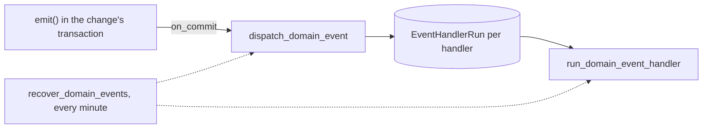

# Domain events

A Domain event records that a change happened in Cinemata. Code that makes the
change records the event in the same database transaction. After the
transaction commits, a Celery worker runs every handler of that event type at
least once. The `events` app implements this outbox. Read
[ADR 0001](../adr/0001-domain-events-through-a-transactional-outbox.md) for the
reasons and the rejected alternatives, and issue #1143 for the design.

The emit point does not know who consumes an event. A consumer subscribes a
handler without editing any emit point, and a failing handler does not affect
the request that made the change or the other handlers.

## Add an event type

Define each type in `events/catalog.py`:

```python
MEDIA_VISIBILITY_CHANGED = define(
    EventSpec("media.visibility_changed", 1, ("media_id", "owner_id", "old_state", "new_state"))
)
```

- Name it `<noun>.<past_tense_verb>`, such as `media.published` or
  `comment.posted`. `define()` rejects any other shape.
- Add a type only when a handler needs it.
- Keep the payload to IDs plus the fields a handler needs once the subject is
  gone. An event about a deletion carries a snapshot, such as the title and the
  owner id. Never put an email address, a token, or another secret in a payload.
- Bump the version whenever the fields change. Events stay for the retention
  period, so a handler must accept every version that is still inside it.

## Emit an event

Call `emit()` inside the transaction that makes the change:

```python
from django.db import transaction

from events.service import emit

with transaction.atomic():
    media.save(update_fields=["state"])
    emit(
        "media.visibility_changed",
        actor=request.user,
        payload={"media_id": media.id, "owner_id": media.user_id, "old_state": old, "new_state": media.state},
    )
```

`emit()` writes a `DomainEvent` row, and the change and its event commit or roll
back together. The dispatch is queued with `transaction.on_commit`, so nothing
runs for a change that rolls back.

- `actor` is the user who made the change. Pass `None` for a change the system
  makes, such as a schedule or a report threshold. An unauthenticated user
  counts as no actor.
- `emit()` raises `TransactionManagementError` outside `transaction.atomic()`,
  `UnknownEventType` for a type the catalogue does not define, and
  `InvalidEventPayload` for a payload that is not a plain JSON object with
  exactly the declared fields.

## Handle an event

Put handlers in an `event_handlers.py` module of the consumer's app. The
`events` app imports that module from every installed app when Django starts.

```python
from events.registry import handles


@handles("media.visibility_changed")
def notify_owner(event):
    media = Media.objects.filter(pk=event.payload["media_id"]).first()
    if media is None:
        return
    ...
```

A handler receives the `DomainEvent`, with its `id`, `type`, `version`,
`occurred_at`, `actor_id` and `payload`.

- **Make the handler idempotent.** A handler runs at least once. A lost worker,
  a recovered task or a replay can run it again. The notification handler, for
  example, keys on `(recipient, type, source_key)`.
- **Assume no order.** Two events can reach their handlers in either order.
- **Complete when the subject is gone.** If the object was deleted after the
  event, such as a comment removed seconds after posting, return without
  raising. A raised exception counts as a failure and is retried.
- **Expect your writes to roll back on failure.** The handler runs inside
  `transaction.atomic()`, together with the update that marks its run as
  succeeded. Queue a Celery task or another side effect with
  `transaction.on_commit()`. A callback runs after the commit, so if it raises,
  the run stays `succeeded`, the error goes to error tracking, and nothing
  retries the callback. When a follow-up must not be lost, `emit()` another
  event in the handler instead: it commits with the handler's writes, and
  recovery dispatches it if its queueing fails.
- **Fan out in batches.** A handler with many recipients, such as followers of a
  creator, queues its own batch tasks (for example 500 recipients per task). The
  dispatcher does not batch.

`python manage.py check` fails with `events.E001` when a handler names a type
that the catalogue does not define.

Tests can use `events.registry.isolated_registry()` to work with their own event
types and handlers without touching the real catalogue.

## Delivery



All tasks use the existing `short_tasks` queue.

1. `dispatch_domain_event` creates one `EventHandlerRun` per handler,
   unique on `(event, handler)`, sets `DomainEvent.dispatched_at`, and queues
   every pending run.
2. `run_domain_event_handler` claims the run, so a duplicate delivery does
   nothing, and calls the handler. It has a 120-second soft and a 150-second hard
   time limit.
3. A run gets up to four attempts. After a failed attempt it is `retrying` and
   runs again after about 30, 60 and 120 seconds. After the fourth failed attempt
   it is `failed` with `reason_code` `handler_error`, and it waits for a replay.
   A run whose handler no longer exists fails at once with `handler_missing`.
   A failed handler does not block the other handlers of the event.

Run states are `pending`, `running`, `retrying`, `succeeded`, and `failed`.

### Recovery

The beat task `recover_domain_events` runs every minute.

- An event left without `dispatched_at` for two minutes is dispatched again. Its
  dispatch task was lost, for example because the broker was down at commit.
- A `pending` or `retrying` run unchanged for ten minutes is queued again.
- A `running` run unchanged for ten minutes lost its worker. It becomes
  `retrying` with `worker_lost` and is queued again, or `failed` with
  `worker_lost` when it has used its fourth attempt.

### Retention

The beat task `cleanup_domain_events` runs daily at 02:45. It deletes an event,
with its runs, once every run has ended (`succeeded` or `failed`) and none
changed in the last 30 days. It locks the runs and checks them again before the
delete, so a replay that starts during cleanup keeps its event. Events are transport, not history: the audit store
is separate. Revisit the 30 days once the event rate is measured.

## Replay failed runs

`replay_domain_event_runs` resets failed runs to `pending` with no attempts and
queues them. Select the runs by event id, or by when the event occurred:

```bash
python manage.py replay_domain_event_runs --event-id 6f1c0a52-2f6e-4f7e-9b8e-3c1d2a4b5e6f
python manage.py replay_domain_event_runs --since 2026-11-01 --until 2026-11-02T12:00
python manage.py replay_domain_event_runs --since 2026-11-01 --handler notifications.event_handlers.notify_owner
python manage.py replay_domain_event_runs --since 2026-11-01 --dry-run
```

- `--event-id` repeats for several events.
- `--since` and `--until` take a date or an ISO 8601 date and time. A time
  without a zone uses `TIME_ZONE`. `--until` is exclusive.
- `--handler` takes the handler's dotted name, as stored in
  `EventHandlerRun.handler` and logged as `event_handler`.
- The command requires `--event-id` or `--since`, so a replay never selects every
  failed run by accident.
- A replay counts as a new run: a replayed run has four attempts again, and its
  event stays for another retention period.

## Observe

The [observability contract](observability-contract.md#domain-events) lists the
metrics and log events. The "Domain events" row of the CinemataCMS
Observability dashboard shows handler results, dispatch lag and the event log.
